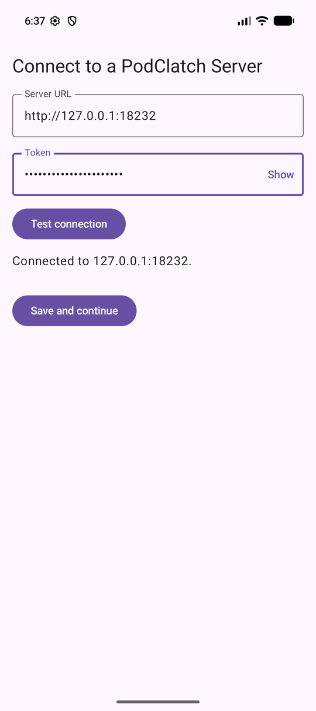
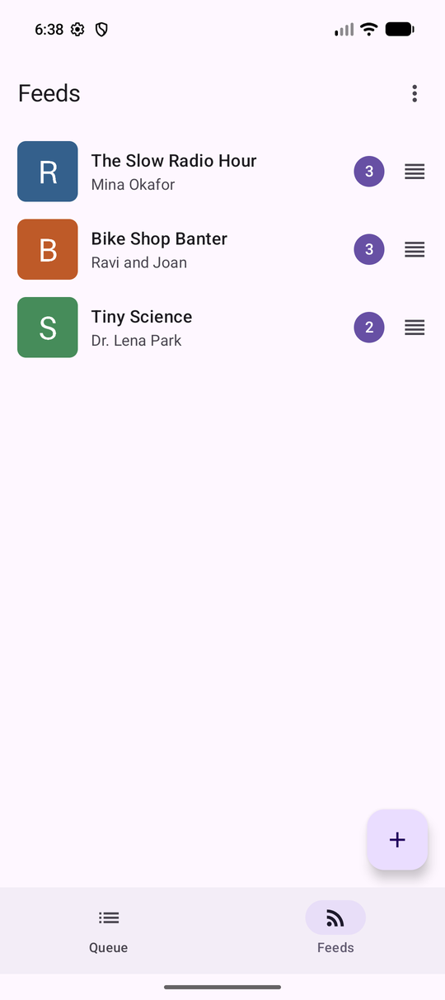
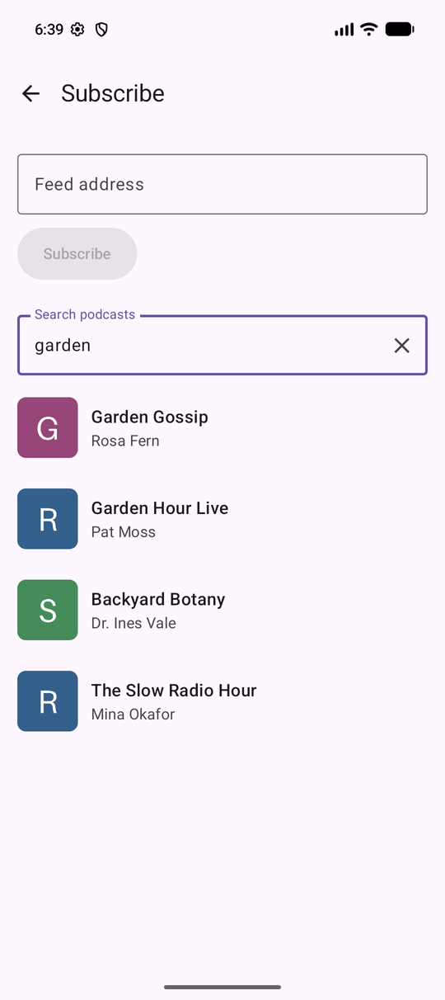
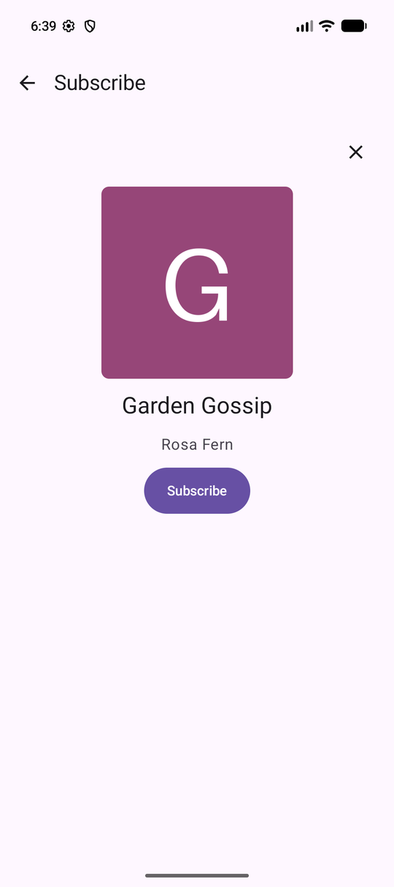
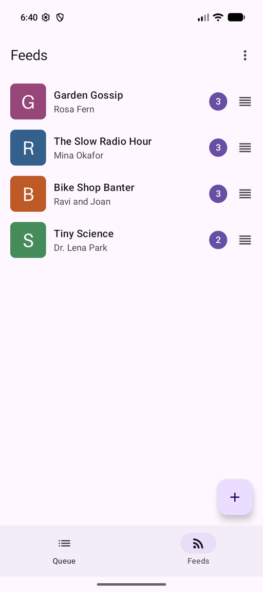
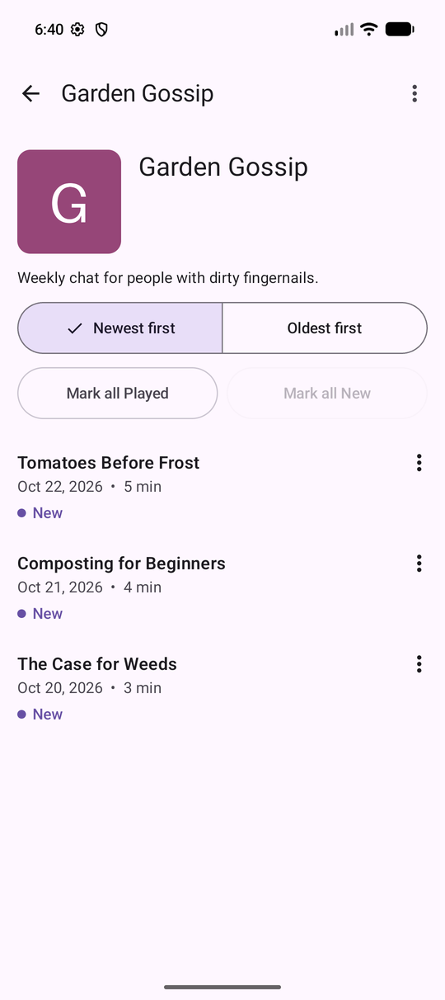
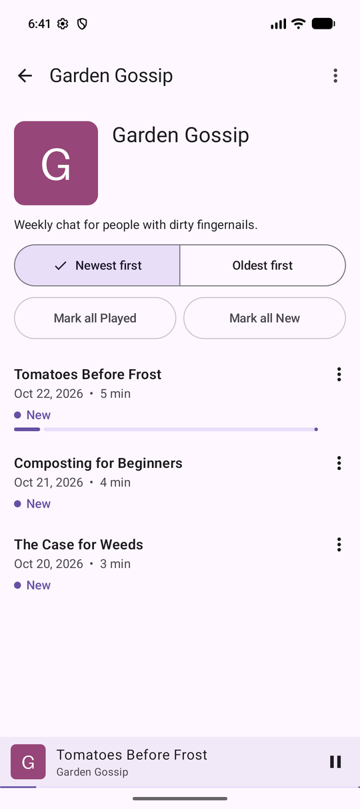
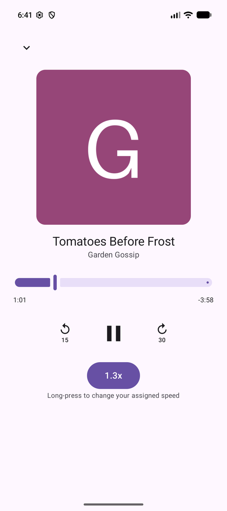
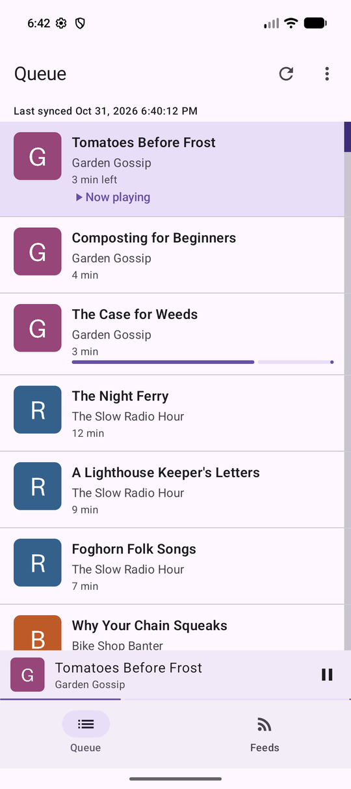
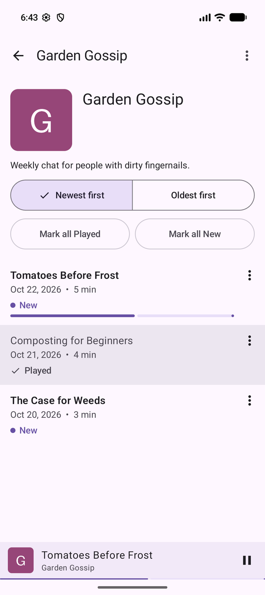

# PodClatch demo

This is a walkthrough of PodClatch in use: the Android app talking to PodClatch Server. Back to the [README](../README.md).

**What you are looking at, honestly.**

- It was recorded on an Android emulator (a Pixel-sized virtual device running Android 17) against a **local** server on the author's machine, started with Docker Compose in its own project. It is **not** the deployed server (nothing is deployed yet; the last section is the place for that).
- The Feeds are made up. They are served by a small fake feed host, the Episodes are generated tones, the artwork is a plain coloured square, and the search directory is a fake that always answers with the same four podcasts. No real feed address, access token, or personal data appears in any image or in the video.
- The video has **no sound**: the emulator is silent.

**Video:** [walkthrough.mp4](demo/walkthrough.mp4), 58 seconds, 2.3 MB. It is the same flow as the ten steps below, in one take.

## The walkthrough

Before step 1, three of the four Feeds (Tiny Science, Bike Shop Banter, and The Slow Radio Hour) were subscribed on the server through its API, so the first Sync has something to show. The fourth (Garden Gossip) is subscribed in the app, in steps 3 and 4.

### 1. Connect to a server



**You:** type the server address and the access token (the token field is masked) and press **Test connection**, then **Save and continue**.
**The system:** the app calls the server's `GET /healthz` and an authenticated endpoint to check both the address and the token, and says "Connected". (The demo server listens on port 18232, reached through `adb reverse`; the README's own examples use 8180.)

### 2. Sync fills the Feeds tab



**You:** open the **Feeds** tab.
**The system:** on connecting, the app runs a Sync (`GET /v1/sync`) and stores the Feeds and their Episodes in its local cache. The badge on each Feed is its number of New Episodes. The order is the Feed Priority.

### 3. Search for a podcast



**You:** press **+**, and type "garden" under "Search podcasts".
**The system:** after a short pause the app calls `GET /v1/search`, and the server asks its directory (here the fake one) and returns the results. The app never talks to the directory itself.

### 4. Preview and subscribe



**You:** tap **Garden Gossip**, then **Subscribe**.
**The system:** the app calls `POST /v1/feeds`. The server fetches and parses the Feed's RSS, stores the Feed at the top of the Feed Priority list, and stores its three Episodes as New. The app then Syncs to pick them up.

### 5. The new Feed is on top



**You:** look at the Feeds tab.
**The system:** a new Feed always goes to the top, so its Episodes play before the others. Drag a Feed's handle to change the order.

### 6. Feed Detail



**You:** tap **Garden Gossip**.
**The system:** the screen is drawn from the local cache, so it opens at once. The Episodes are listed in the Feed's Listen Order (Newest first here) and all start as New.

### 7. Play an Episode



**You:** tap **Tomatoes Before Frost**.
**The system:** playback starts at once by streaming the audio from the audio host (in real use, the podcast publisher, never the PodClatch Server), and in the background the same file is downloaded. The mini player appears, and the Episode's row shows its progress.

### 8. The full player



**You:** tap the mini player.
**The system:** the full player shows the position and time left. Skip back is 15 seconds and skip forward is 30 by default (change them in Settings). The **1.3x** button switches between your assigned speed and normal speed; long-press it to change the assigned speed.

### 9. The Queue



**You:** open the **Queue** tab.
**The system:** the Queue is worked out, not stored: the New Episodes that are downloaded or downloading, in Feed Priority order and then each Feed's Listen Order. The playing Episode is highlighted, and the bar under the third one is its download in progress (this demo throttles that Feed's audio so you can see it).

### 10. Mark an Episode Played



**You:** in Feed Detail, open an Episode's menu and choose **Mark as Played**.
**The system:** the row changes at once and leaves the Queue. The change goes to the app's outbox and is sent to the server (`POST /v1/episodes/state`). After the run, the server's own API (`GET /v1/feeds/{id}/episodes`) showed that Episode with a `playedAt` time and the other two Episodes without one, so the state really reached the server.

## More screens

| Screen | Image |
| --- | --- |
| The Queue in the dark theme (the app follows the system theme) | [queue-dark.png](screenshots/queue-dark.png) |
| Settings: Playback, Downloads, and Sync and notifications | [settings.png](screenshots/settings.png) |

## Take the screenshots again

You need Docker, Python 3, an emulator, and `adb`. Use your **own** Compose project and a free port, never your everyday `podclatch` stack, and name the emulator with `-s emulator-5554` on every `adb` command so a real phone is never touched. Shown for Git Bash; the placeholders are in angle brackets.

1. Start a separate server stack with its own image tag, so your normal image is not retagged:

   ```
   printf 'PODCLATCH_TOKEN=<a token you choose>\nPOSTGRES_PASSWORD=<a password you choose>\nPODCLATCH_PORT=18232\n' > <scratch dir>/demo.env
   printf 'services:\n  server:\n    image: podclatch-server:demo\n' > <scratch dir>/demo-override.yaml
   docker compose -p podclatch-demo --env-file <scratch dir>/demo.env -f docker-compose.yaml -f docker-compose.integration.yaml -f <scratch dir>/demo-override.yaml up -d --build --wait
   docker compose -p podclatch-demo --env-file <scratch dir>/demo.env -f docker-compose.yaml -f docker-compose.integration.yaml -f <scratch dir>/demo-override.yaml port feedhost 8080
   ```

   The last command prints the fake feed host's port. Keep both files outside the repository.
2. Serve the audio and the artwork, and seed the data (set `PODCLATCH_TOKEN` to the token you chose, in the same shell):

   ```
   python3 -I android/tools/audio_fixture.py --port 8191 &
   python3 docs/demo/seed_demo.py --feedhost http://127.0.0.1:<feed host port> --server http://127.0.0.1:18232 --artwork-dir <scratch dir>/art
   python3 -I -m http.server 8192 --bind 127.0.0.1 --directory <scratch dir>/art &
   ```

   `seed_demo.py` is described at the top of the file. It needs Pillow (`pip install pillow`) only for the artwork.
3. Install the debug build and let the emulator reach the three ports:

   ```
   (cd android && ANDROID_SERIAL=emulator-5554 ./gradlew installDebug)
   for p in 18232 8191 8192; do adb -s emulator-5554 reverse tcp:$p tcp:$p; done
   adb -s emulator-5554 shell pm grant com.podclatch android.permission.ACCESS_LOCAL_NETWORK
   adb -s emulator-5554 shell pm grant com.podclatch android.permission.POST_NOTIFICATIONS
   adb -s emulator-5554 shell cmd uimode night no
   ```

   Android may show an "Android App Compatibility" (16 KB) dialog each time the app starts; press **Don't Show Again** before capturing.
4. Open the app and follow the ten steps above (server `http://127.0.0.1:18232`, your token, and a search for "garden"). Capture each screen, scaled to 540 pixels wide, which keeps every image under 300 KB:

   ```
   adb -s emulator-5554 exec-out screencap -p > shot.png
   python3 -c "from PIL import Image; i = Image.open('shot.png').convert('RGB'); i.resize((540, round(i.height * 540 / i.width)), Image.LANCZOS).save('docs/screenshots/<name>.png', optimize=True)"
   ```

   Switch to the dark theme for `queue-dark.png` with `adb -s emulator-5554 shell cmd uimode night yes`, and back with `night no`.
5. Record the video the same way, in one take, with no sound and under 90 seconds and 10 MB:

   ```
   adb -s emulator-5554 shell screenrecord --time-limit 88 --bit-rate 700000 --size 540x1212 /sdcard/walkthrough.mp4
   adb -s emulator-5554 pull /sdcard/walkthrough.mp4 docs/demo/walkthrough.mp4
   ```

   Stop the recording early with `adb -s emulator-5554 shell pkill -2 screenrecord`. The recording in this repository was driven by `adb shell input tap` commands while `screenrecord` ran.
6. Clean up, touching only what you started: stop the two background Python processes, run `adb -s emulator-5554 reverse --remove tcp:18232` (and the same for 8191 and 8192), and remove your project with its volume and image: `docker compose -p podclatch-demo --env-file <scratch dir>/demo.env -f docker-compose.yaml -f docker-compose.integration.yaml -f <scratch dir>/demo-override.yaml down -v --remove-orphans`, then `docker image rm podclatch-server:demo`.

## Against the deployed server

`TODO(human)`: nothing is deployed yet, so there is no recording of the app talking to a deployed server. After you deploy `dev` (see Deployment in the [README](../README.md) and [infra/README.md](../infra/README.md)), replace this paragraph with a short screen recording, or annotated screenshots, of the app talking to the `https://...awsapprunner.com` address: **Test connection** on the connection screen, a **Sync**, and playing an Episode. You can also record a real phone with sound. Then put a link to it here and in the README's Demo section. Do not paste the access token into the recording; the token field is masked, so leave it that way.
